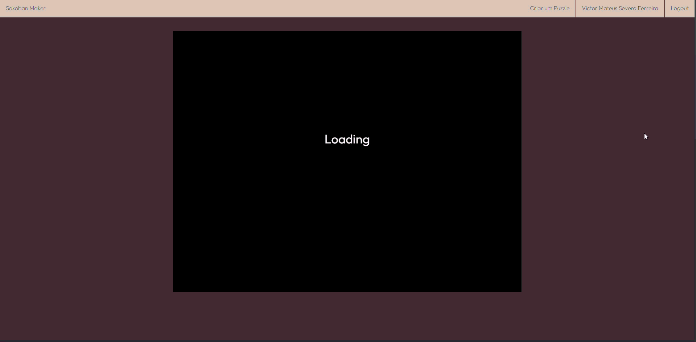

# Projeto Final



## Acesso

[https://project4-2026b-victormsferreira-production.up.railway.app](https://project4-2026b-victormsferreira-production.up.railway.app)

## Desenvolvedor(a) / Desenvolvedor(es/as)
Victor Mateus Severo Ferreira

## Proposta
Realizar um projeto novo que combina aspectos dos projetos 2 e 3, fazendo um jogo com multiplayer síncrono com UGC, utilizando login federado para criação de contas e o uso de um framework para o frontend.

## Desenvolvimento

### Processo
Como havia gostado de utilizar o PocketBase no projeto passado, decidi utilizar ele também como o backend para esse projeto. Porém, como o PocketBase contém SDKs oficiais apenas para JavaScript e Dart, precisei, como um primeiro passo, implementar uma SDK similar para Rust, criando uma abstração sobre a API REST do PB.

Essa abstração foi relativamente simples de implementar. Iniciei criando um struct que armazena a URL da instância do PB e os dados de autenticação, e implementa metódos get/post/patch/delete utilizando inicialmente reqwest, mas posteriormente gloo_net, para mandar requests HTTP para o servidor PB. Após isso, esses metódos foram utilizados para implementar funções similares às presentes no SDK em JavaScript, como os metódos CRUD sobre coleções e metódos de autenticação com email/senha e OAuth2.

Após criar e testar pb.rs, comecei o desenvolvimento do site público utilizando o framework Yew. Iniciei utilizando o tutorial do Yew como um boilerplate, mas substituindo a requisição dele com o uso de pb.rs. Fazer isso funcionar demorou algum tempo, pois o uso de metódos async e a necessidade de ownership compartilhada do PocketBase entre vários escopos me levaram a refatorar diversos aspectos da abstração e precisei passar bastante tempo aprendendo sobre como utilizar pointeiros Rc e RefCell do Rust.

Após conseguir fazer esse tutorial funcionar, comecei a criar o sistema de autenticação no site, criando os componentes LoginForm e SignUpForm, que possuem entradas para os campos de autenticação e realizam o login e registro. Após fazer a autenticação com email e senha funcionar, realizei a implementação do login federado utilizando OAuth2. Para isso, criei um componente OAuth2Login, que faz uma requisição ao PocketBase de todos os provedores de login OAuth2 que estão disponíveis para os usuários e cria botões de login com callbacks que realizam a autenticação com o provedor recebido. Também tentei realizar a renderização da logo do provedor no botão através do SVG provido na resposta do PocketBase, porém não consegui fazer com que ele escale própriamente para caber no botão.

Após isso, implementei um navbar de cabeçalho simples com um link para a frontpage do site, e, caso o usuário esteja autenticado, um link para seu perfil, ou botões de login/registro caso contrário. A navegação por páginas foi feita através do Router do Yew, que permite a criação de um SPA com rotas diferentes.

Após isso, iniciei a implementação do jogo. Inicialmente queria utilizar WebGL para a criação de um jogo 3D, porém devido a ter pouco tempo restante, decidi utilizar um simples canvas 2D, similar a implementação do trabalho 2. Porém, trabalhar com a API Canvas foi mais complexo do que eu esperava. Yew, como um framework dedicado a criação do DOM HTML, não possuí um sistema para trabalhar com canvas, portanto tive que utilizar a biblioteca web_sys, que é de nível mais baixo e abstraí diretamente sobre a API do navegador. A API de animação, em particular, foi irritante de trabalhar. Para ela, utilizei a biblioteca gloo_render que provê uma abstração sobre a função RequestAnimationFrame do navegador, porém, essa função retorna um objeto AnimationFrame, que deve ser mantido em memória, caso contrário a requisição para o quadro de animação é cancelado. Demorei algum tempo para fazer ele funcionar, porém eventualmente consegui criando um `Rc<RefCell<AnimationFrame>>` no componente, que é clonado e capturado pela closure que é recebida pelo RequestAnimationFrame, mantendo esse objeto sempre em memória enquanto o componente esteja ativo.

Após isso, decidi que o jogo que iria implementar seria um simples sokoban. Fiz uma implementação dele baseado em um tutorial utilizando hecs, um framework de Entity-Component-System. Implementei também um simples editor de níveis, e utilizei o pb.rs para salvar, visualizar, listar, etc os puzzles no servidor. Na lista de puzzles, há uma imagem thumbnail. Passei bastante tempo tentando trabalhar com o canvas para a geração de uma thumbnail, porém não consegui fazer com que ela seja enviada para o PB, e portanto deixei essas thumbnails como apenas imagens placeholders.

Para realizar o deploy, tentei várias coisas, mas por fim consegui fazer o railway funcionar com a criação de um Dockerfile simples que obtém a versão usada do PocketBase e copia os diretórios de migrações e público.

Em retrospectiva, o projeto é simples, porém tive muitas dificuldades ao implementa-lo, e acredito que isso tenha sido devido a uma má escolha de tecnologias:
- Rust é uma linguagem com a qual eu tinha familiaridade, porém nunca havia feito um projeto desse tamanho nela, portanto o processo envolveu bastante tempo aprendendo sobre a linguagem em si.
- Acredito que Yew seja um bom framework, porém acredito que ele seja mal documentado, com a documentação frequentemente aparentando assumir que o usuário já tenha bastante experiência com React e frameworks similares.
- Além disso, diversos aspectos do desenvolvimento necessitaram o uso da API web_sys, que, como um simples wrapper automático de nível mais baixo sobre a API do navegador, possuí diversos problemas.
- Enquanto a criação do pb.rs foi bem simples para dados simples, processos mais complexos, como o sistema OAuth2, demoraram bastante para implementar, e o upload de arquivos, que estava tentando realizar para o sistema de thumbnails, se demonstrou completamente inviável.


### Trechos de código

O componente que cria os botões para login OAuth2
```rust
fn OAuth2Login(pb: Rc<Pocketbase>) -> HtmlResult {
    let auth_methods = {
        let pb = Rc::clone(&pb);
        use_future(|| async move { pb.list_auth_methods("users").await })
    };
    

    match &auth_methods {
        Ok(auths) => Ok(html! {
            for provider in &auths.oauth2.providers {
                <button type="button" onclick={
                    let name = provider.name.clone();
                    let verifier = provider.code_verifier.clone();
                    let url = format!("{}{}", provider.auth_url, REDIRECT_URL);
                    Callback::from(move |_| {
                        LocalStorage::set("ProviderName", &name).unwrap();
                        LocalStorage::set("CodeVerifier", &verifier).unwrap();
                        let window = window().unwrap();
                        log!(&url);
                        window.document().unwrap().location().unwrap().set_href(&url).unwrap();
                })}>
                {&provider.display_name}
                 </button>
            }
        }),
        Err(_) => Ok(html! {<p>{"Erro carregando Metódos de Autenticação"}</p>}),
    }
}
```

Realizando um request POST para o PocketBase
```rs
pub async fn post<T: for<'a> Deserialize<'a>>(
    &self,
    path: &str,
    body: &impl Serialize,
) -> Result<T, PbErr> {
    let url: String = format!("{}/{}", self.addr, path);
    let request = Request::post(&url);
    let response = if let Some(auth_store) = &self.auth_store {
        request.header("Authorization", &auth_store.token)
    } else {
        request
    }
    .json(body)
    .unwrap()
    .send()
    .await;

    if let Ok(body) = response {
        match body.json::<T>().await {
            Ok(result) => {
                return Ok(result);
            }
            Err(_e) => {
                return Err(PbErr::ParseFail);
            }
        }
    }
    Err(PbErr::RequestFail)
}
```

Realizando a requisição de um frame de animação para o navegador.
```rs
fn game_tick(
    game_state: Rc<RefCell<GameState>>,
    _t_a: f64,
    t_b: f64,
    frame_handler: Rc<RefCell<Option<AnimationFrame>>>,
) {
    game_state.borrow_mut().on_draw();
    let cb = {
        let frame_handler = frame_handler.clone();
        move |t| {
            let t_a = t_b;
            let t_b = t;
            GameState::game_tick(game_state.clone(), t_a, t_b, frame_handler);
        }
    };
    *frame_handler.borrow_mut() = Some(request_animation_frame(cb));
}
```


## Tecnologias

### Linguagens e afins

- Rust
- Yew + web_sys
- CSS
- PocketBase
- Docker
- Diversas bibliotecas Rust listadas em cargo.toml


### Ambiente de desenvolvimento

- VSCode
- Cargo e Trunk


## Referências e créditos

- [Tutorial Yew](https://yew.rs/docs/tutorial)
- [Tutorial usado como referência para implementação de um Sokoban](https://sokoban.iolivia.me/c01-00-intro)
- [Assets gráficos grátis](https://kenney.nl)
- [Documentação Web Mozilla](https://developer.mozilla.org/en-US/docs/Web/)
- [Documentação do PocketBase](https://pocketbase.io/docs/)
- Páginas docs.rs para todas as bibliotecas rust utilizadas.

---
Projeto entregue para a disciplina de [Desenvolvimento de Software para a Web](http://github.com/andreainfufsm/elc1090-2026b) em 2026b